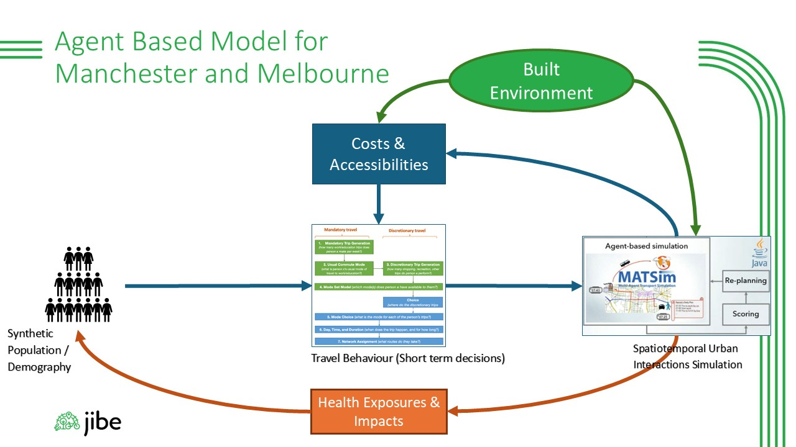
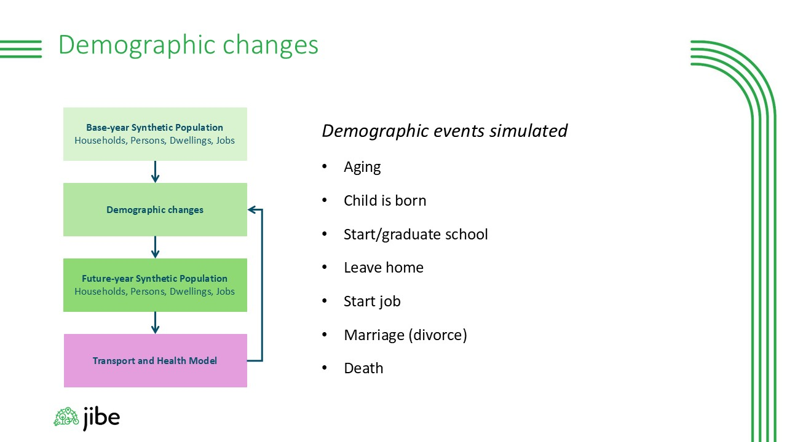
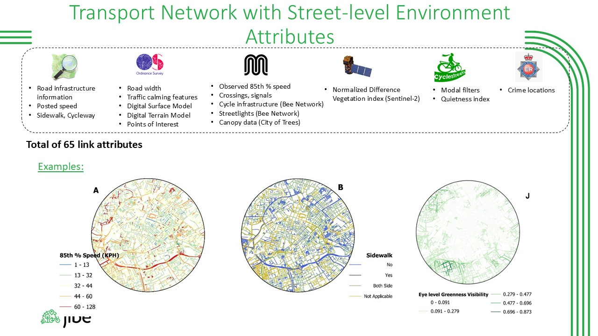
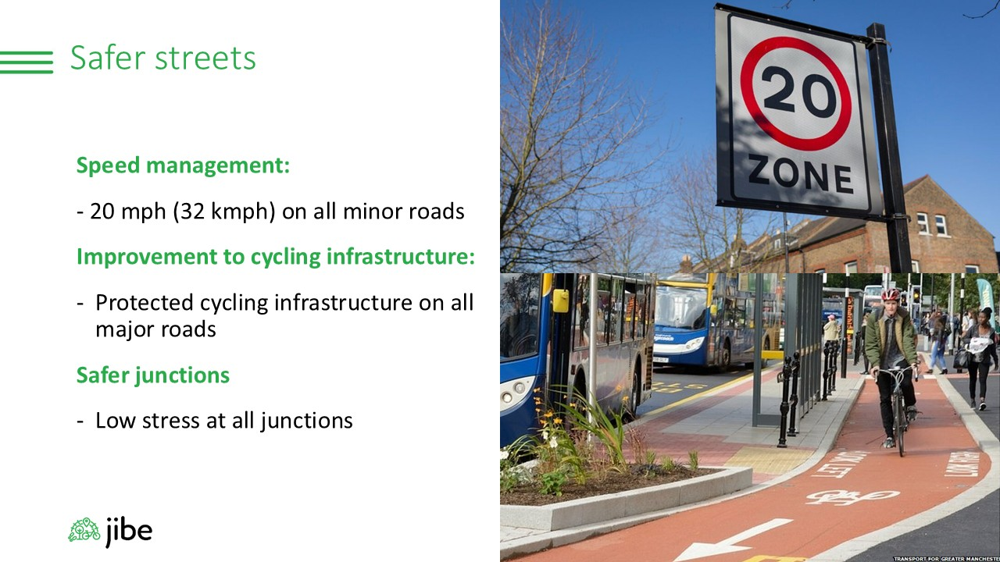
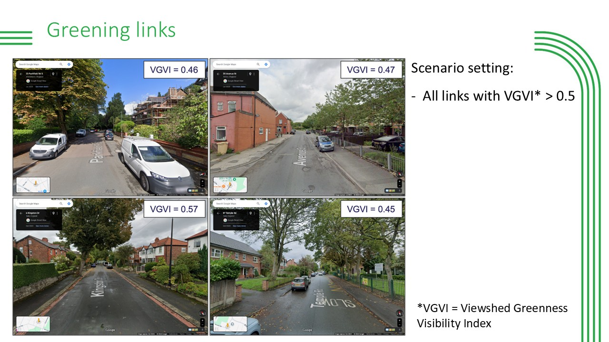
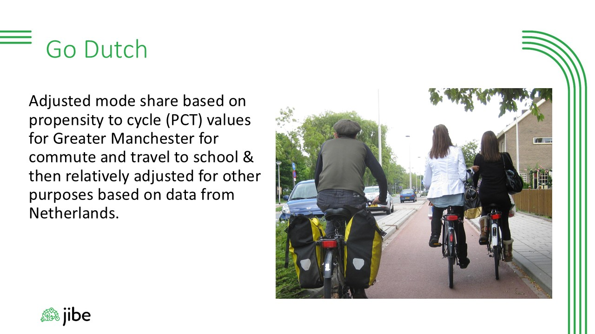
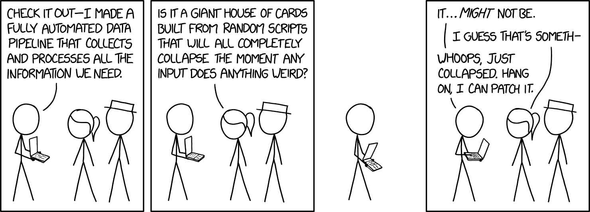

---
format:
  revealjs:
    css: style.css
    embed-resources: true
    theme: simple
    revealjs-plugins:
      - a11y
    revealjs-a11y:
      # 0.2.3's menus introduce ARIA failures; retain our slide-menu handling.
      slide-menu-a11y: false
      menu: false
      # Use the extension's core accessibility fixes without extra UI/shortcuts.
      font-size-controls: false
      font-selection: false
      text-spacing: false
      transcript: false
      slide-change-cue: false
    slide-number: true
    code-line-numbers: false
    highlight-style: github
    preview-links: auto
    keyboard: true
    touch: true
    help: true
    link-external-newwindow: true
    mermaid:
      theme: neutral
execute:
  echo: true
  eval: false
license: "CC0 1.0 Universal"
pagetitle: "Computational Tools"
author-meta: "Ali Abbas"
date-meta: "2026-10-20"
lang: "en"
dir: "ltr"
---

## Computational Projects {.hero .center background-color="#FFD600"}

::: tag
Computational Tools, Reproducible Data Pipeline
:::

::: hero-sub
Overview of [two projects]{.sticker}
:::

::: hero-author
Ali Abbas
:::

# Introduction

Senior data scientist and technical leader with 13+ yearsʼ experience in transport and health modelling.

1.  Build production analytics systems, data pipelines, and decision-support tools.
2.  Work with Python, SQL, Java, and R.
3.  Develop statistical models, dashboards, and large-scale data processing.
4.  Turn complex analysis into clear, usable evidence. 
5.  Work across technical and non-technical teams with sensitive data.

```{mermaid}
%%| eval: true
%%| echo: false
%%{init: {
  "htmlLabels": false,
  "flowchart": {"htmlLabels": false, "padding": 16},
  "themeVariables": {
    "fontFamily": "Space Grotesk, sans-serif",
    "fontSize": "20px"
  }
}}%%
flowchart LR
    P[Data] --> I[Pipeline] --> T[Model] --> C[Dashboard]

    classDef plan fill:#ffd600,stroke:black,stroke-width:3px,color:black
    classDef implement fill:#00c853,stroke:black,stroke-width:3px,color:black
    classDef test fill:#ff4081,stroke:black,stroke-width:3px,color:black
    classDef commit fill:#065f46,stroke:black,stroke-width:3px,color:white

    class P plan
    class I implement
    class T test
    class C commit
    
```


# Joining Impact models of transport with spatial measures of the Built Environment (JIBE) {background-color="#FFD600"}

Integrated Transport, Built Environment, and Health Model with Scenarios

## JIBE MODEL



JIBE links the built environment, transport behaviour, and health impacts. It tests how urban and transport policies may affect physical activity, air-pollution,  greening, noise, injuries, and health outcomes in Greater Manchester and Melbourne

## Demographics Changes



## Transport Network



# Scenarios {background-color="#FFD600"}

## Safe Streets



## Green



## Go Dutch



## Combined Scenarios


| Scenario     | Description                                                |
|-------------------|-----------------------------------------------------|
| Baseline     | Current Policies and Trends                                |
| Safe Streets | Safer, lower-traffic routes                                |
| Green        | More green space and greener routes                        |
| Go Dutch     | Cycling infrastructure and behaviour closer to Dutch norms |

# Model Workflow {background-color="#FFD600"}

## Data Pipeline



## What is the model workflow?

The *workflow* brings together data, code, processing, and HPC resources in a repeatable structure.

```{mermaid}
%%| eval: true
%%| echo: false
%%{init: {
  "htmlLabels": false,
  "flowchart": {"htmlLabels": false, "padding": 16},
  "themeVariables": {
    "fontFamily": "Space Grotesk, sans-serif",
    "fontSize": "20px"
  }
}}%%
flowchart LR
    subgraph Host["Data"]
        M[GitLab]:::gitlab <--> C[Sharepoint]:::sharepoint
    end

    C <-- "uses" --> S[GitHub]:::github
    S <-- "runs on" --> T[High Performance Computing]:::hpc
    T -->|"analysed using"| U[Java & R]:::analysis
    U -->|"visualised by"| V[Shiny]:::Visualisation

    classDef gitlab fill:lightgray,stroke:black,stroke-width:3px,color:black
    classDef sharepoint fill:lightgray,stroke:black,stroke-width:3px,color:black
    classDef github fill:#00c853,stroke:black,stroke-width:3px,color:black
    classDef hpc fill:#ff4081,stroke:black,stroke-width:3px,color:black
    classDef analysis fill:#4b5563,stroke:black,stroke-width:3px,color:white
    classDef Visualisation fill:#065f46,stroke:black,stroke-width:3px,color:white
    style Host fill:#ffd600,stroke:black,stroke-width:3px,color:black
    
```

:::::: grid-3
::: {.card .yellow}
**Data**: data sources and scenario specific configurations
:::

::: {.card .green}
**Code**: model implementation
:::

::: {.card .pink}
**HPC**: architecture-specific scripts, tests, submission scripts, and logs
:::

<!-- ::: {.card .gray} -->

<!-- **Analysis**: Java/R scripts to test, read and provide centralised datasets. -->

<!-- ::: -->

<!-- ::: {.card .forest} -->

<!-- **Shiny**: An interactive application -->

<!-- ::: -->
::::::

# Bottleneck {background-color="#FFD600"}

## The challenge

The Java model answered important questions, but running it had become slow.

-   Two high-performance desktops supported the work.

-   One 30-year scenario took about 7 days.

-   Multiple scenarios, checks, and sharing were hard to scale.

**Goal**: make the workflow faster, more reliable, and usable by the wider team.

## Design Principle

Start with the real problem: A useful workflow needed to:

-   Run on suitable infrastructure.

-   Catch data and code problems early.

-   Make failures easier to understand and recover from.

-   Reduce reliance on one person's knowledge.

-   Turn outputs into results colleagues can explore.

**Design principle**: make the whole journey repeatable, from inputs to interpretable results.


## Moving to HPC

Learnt how to use the HPC, and then adapted the model for it.

Then I built familiarity with the practical differences that affect a run:

-   Reviewed available architectures, including **Ice Lake** and **Sapphire**.
-   Compiled the Java model for the target architecture.
-   Used Slurm to submit and manage jobs.
-   Built a test environment suite before model runs

This gave us a foundation for running the same model consistently on the infrastructure available.

## Catch problems early

Make failures cheaper to find: a long job is a costly place to find a simple error.

**Pre-run checks included:**

-   Confirming required data/files exist.
-   Check columns, data quality, and missing values.
-   Impute where appropriate, or stop with a clear error.
-   Verify code and compiled model before job submission.
-   Log failures and feed fixes back into the workflow.

## Make it usable

Make it usable by the team: the HPC system had no shared team area, so each person needed their own setup.

-   Co-wrote step-by-step setup and run instructions.
-   Asked colleagues to follow them and revised the guidance.
-   Documented common failures and their fixes.
-   Added lessons from real runs to the tests.

**Adoption mattered:** a workflow only helps the team if other people can set it up and use it confidently.

## Results

Run scenarios in parallel

-   Estimated model runtime: around **20 hours**.
-   Including post-processing and summarising: **less than 2 days**.
-   Before: around **7 days for one scenario**.

That is a reduction from approximately 7 days to under 2 days—a **roughly 71% improvement** in elapsed time, using the two-day comparison.

The practical gain was not just speed: the team could get to comparable, reviewable results sooner.

## From outputs to evidence

Turn outputs into evidence: faster runs still produce large datasets.

-   Transfer outputs to university managed network drive - IFS
-   Process data with Arrow, DuckDB, and Parquet.
-   Run exploratory checks.
-   Summarise exposure, travel behaviour, and health impacts.
-   Publish results for review and visualisation.

```{mermaid}
%%| eval: true
%%| echo: false
%%{init: {
  "htmlLabels": false,
  "flowchart": {"htmlLabels": false, "padding": 16},
  "themeVariables": {
    "fontFamily": "Space Grotesk, sans-serif",
    "fontSize": "20px"
  }
}}%%
flowchart LR
    P[Model Outputs] --> I[DuckDB] --> T[Parquet] --> C[Shiny]

    classDef plan fill:#ffd600,stroke:black,stroke-width:3px,color:black
    classDef implement fill:#00c853,stroke:black,stroke-width:3px,color:black
    classDef test fill:#ff4081,stroke:black,stroke-width:3px,color:black
    classDef commit fill:#065f46,stroke:black,stroke-width:3px,color:white

    class P plan
    class I implement
    class T test
    class C commit
    
```

<!-- A data-engineering diagram: Model outputs ? Parquet ? DuckDB/Arrow ? summary tables ? Shiny app -->

## Shiny app

**Put results in users' hands** The Shiny app lets colleagues explore results without handling large model. Users can filter and compare by:

-   Age group

-   Gender

-   Local Authority

-   Index of Multiple Deprivation

They can view figures and tables, download outputs, revisit previous runs, and compare model versions.

## Lessons

What I learned

-   Plan the whole workflow, not only the model run.

-   Test before submission.

-   Treat logging as part of the worflow.

-   Design for the team's actual environment.

-   Validate documentation with users.

-   Build for reproducibility and versioned comparisons.

## Closing

From slow runs to usable evidence:

-   Four scenarios now run in parallel.

-   Modelling and post-processing finishes:

::::: grid-2
::: {.card .red .stat}
[From 7 days]{.num}
:::

::: {.card .green .stat}
[To 2 days]{.num}
:::
:::::

-   The processing workflow and Shiny app make outputs easier to check, explore, compare, and share.

-   A computational tool succeeds when it improves both the technical process and the experience of the people using it.

# Messy and unorganized datasets {background-color="#FFD600"}

## Non-standardised travel survey

-   Messy travel surveys: travel surveys behind Integrated Transport and Health Model (ITHIM) vary widely in quality, definitions, structure, and detail. Some are unusable; most need substantial preparation.
-   **Solution**: a colleague and I developed a shared preprocessing protocol to prepare usable surveys for the model.

Link: [github.com/ITHIM/\
TravelSurveyPreprocessing](https://github.com/ITHIM/TravelSurveyPreprocessing/blob/main/Protocol/Protocol.md)

## How we assessed surveys

**How we worked through it?** For each survey, we:

-   Understood trip definitions, time windows, and coverage.
-   Reproduced published weighted results.
-   Judged whether the survey was fit for purpose.
-   Preprocessed usable surveys into standardised trip and stage data.
-   Passed the result to ITHIM.

Replication doubled as validation. If published results did not reproduce, we revisited our interpretation.


```{mermaid}
%%| eval: true
%%| echo: false
%%{init: {
  "htmlLabels": false,
  "flowchart": {"htmlLabels": false, "padding": 16},
  "themeVariables": {
    "fontFamily": "Space Grotesk, sans-serif",
    "fontSize": "20px"
  }
}}%%
flowchart LR
    A[Survey intake:<br/>data + report] --> B[Understanding:<br/>trip definition,<br/>time window]
    B --> C{Fit for<br/>purpose?}
    C -- no --> X[Not used<br/>for the model]
    C -- yes --> D[Preprocessing:<br/>coverage, modes,<br/>stages]
    D --> E[Standardised<br/>stage/trip<br/>dataset]
    E --> F[ITHIM<br/>model]
    style X fill:#f8d7da,stroke:#a71d2a
    style E fill:#d4edda,stroke:#1e7a34
```

## What standardisation meant for us

::::: columns
::: {.column width="48%"}
Key variables

([Protocol](https://github.com/ITHIM/TravelSurveyPreprocessing/blob/main/Protocol/Protocol.md)).

| Variable | Role |
|------------------------------------|------------------------------------|
| `trip_id`, `trip_mode` | Trip identity & main mode |
| `trip_duration` | Minutes, derived from times if needed |
| `stage_id`, `stage_mode`, `stage_duration` | Stage-level |
| `participant_id`, `sex`, `age` | Person linkage |
:::

::: {.column width="52%"}
Languages and categories matter

| Survey mode                | Standard    | Rank |
|----------------------------|-------------|------|
| Metro, tram, train         | Metro/train | 1    |
| BRT, minibus, informal bus | Bus         | 2    |
| App or collective taxi     | Taxi        | 3    |
| Car, SUV, pickup           | Car         | 4    |
| Mototaxi                   | Motorcycle  | 5    |
| Walking                    | Walk        | 8    |

The same hierarchy gives each trip its main mode.
:::
:::::


## Making it centralised and repeatable

**Bringing it together.**

- Combined household, people, and trip files, sometimes with additional stage information.

- Geography coverage

**Making it repeatable.** 

- Documenting trip definitions, geographic coverage, mode mappings, and missing stage duration. 
- Replication enhances validation, as it checks that we're interpreting the data correctly.


## Outcome

What came out of it

-   Inconsistent, city-specific surveys became a documented input for ITHIM.
-   Comparisons between cities became fairer.
-   Every processing rule was explicit and reviewable.

<!-- Add ?gure: A small world map with dots for contributing cities or surveys, if city coverage is available. Otherwise, reuse the standardised-table graphic with a validation tick. -->

<!-- Source: ITHIM/TravelSurveyPreprocessing protocol. -->

# How does AI fit in all of this? {background-color="#FFD600"}

## Machine Learning


## AI integration

Not fully integrated in the workflows, but AI (LLMs) have been carefully applied throughout the workflows. Some of the examples include:

-   Re-factoring code
-   Streamline data pipelines
-   Standardizing documentation
-   Generate documentation for legacy systems

## Major AI principles

1.  **Plan before coding**. Agree the approach and open questions first.
2.  **Use a repeatable loop**. Plan, implement, test, commit; check each change against the plan.
```{mermaid}
%%| eval: true
%%| echo: false
%%{init: {
  "htmlLabels": false,
  "flowchart": {"htmlLabels": false, "padding": 16},
  "themeVariables": {
    "fontFamily": "Space Grotesk, sans-serif",
    "fontSize": "20px"
  }
}}%%
flowchart LR
    P[Plan] --> I[Implement] --> T[Test] --> C[Commit]

    classDef plan fill:#ffd600,stroke:black,stroke-width:3px,color:black
    classDef implement fill:#00c853,stroke:black,stroke-width:3px,color:black
    classDef test fill:#ff4081,stroke:black,stroke-width:3px,color:black
    classDef commit fill:#065f46,stroke:black,stroke-width:3px,color:white

    class P plan
    class I implement
    class T test
    class C commit
    
```

3.  **Design clear modules**. Keep interfaces simple and functionality cohesive.
4.  **Make quality testable**. Tests give the agent fast, concrete feedback.
5.  **Keep human judgement at the boundaries**. Architect's own requirements, architecture, and interfaces set the boundaries.


<small>Sources: [Planning loop](https://www.aihero.dev/my-agents-md-file-for-building-plans-you-actually-read); [AI-friendly codebases](https://www.aihero.dev/how-to-make-codebases-ai-agents-love).</small>

## Minor AI principles

1.  **Keep root agent instructions short.** Include essentials that apply across tasks; avoid burying the agent in context.
2.  **Use progressive disclosure.** Link to focused docs or skills so task-specific guidance is loaded only when useful.
3.  **Scope guidance to the right level.** Put shared rules at the repository root and package-specific guidance in subdirectories.
4.  **Make instructions actionable.** Remove vague, redundant, or obvious rules that do not guide a concrete decision.
5.  **Document practical project facts.** Specify items such as the package manager and non-standard build or type-check commands.

<small>Source: [A Complete Guide to AGENTS.md](https://www.aihero.dev/a-complete-guide-to-agents-md).</small>

# Conclusion {background-color="#FFD600"}

## From data to usable evidence

- **JIBE:** Four scenarios run in parallel; results are ready in under two days.
- **ITHIM:** A shared protocol turns varied travel surveys into consistent, reviewable inputs.
- **Across both projects:** Reproducible workflows make analysis easier to test, compare, and share.
- **AI:** Use it selectively - plan first, give clear instructions, and keep humans in charge of key decisions.

### Better tools. Clearer evidence. More usable results.

# Thank You {background-color="#FFD600"}